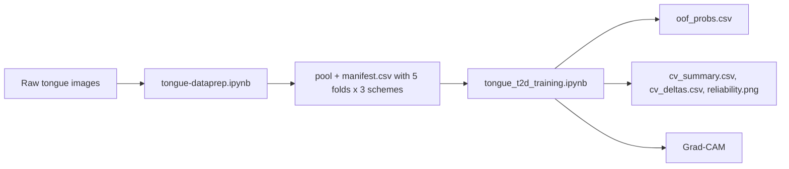

# Tongue Diabetes Detection

> 🧬 Leakage-safe tongue image pipeline for type 2 diabetes detection, built with Kaggle notebooks, CNN transfer learning, and Grad-CAM explainability.

## ✨ At a glance

| Item | Details |
|---|---|
| 🧪 Data prep | Offline augmentation, class balancing, identity clusters, 5-fold group CV manifest, leakage checks |
| 🧠 Training | EfficientNet-B2, ResNet-50, MobileNetV3-Large |
| 📊 Evaluation | 5-fold CV under three grouping schemes, identity-cluster bootstrap intervals, paired leakage differences, screening PPV, calibration |
| 🔍 Explainability | Grad-CAM visualizations and confusion matrices |
| 📦 Output | Kaggle-ready pool + `manifest.csv`, out-of-fold predictions, summary tables and plots |

## 📚 What’s inside

- [tongue-dataprep.ipynb](tongue-dataprep.ipynb) - offline augmentation, identity clustering, fold assignment, leakage checks, and Kaggle-ready export.
- [tongue_t2d_training.ipynb](tongue_t2d_training.ipynb) - cross-validated training, threshold tuning, pooled out-of-fold evaluation, colour baseline, and Grad-CAM.
- [notebooks_explanation.md](notebooks_explanation.md) - plain-language description of the notebook workflow.

## 🧭 Workflow

## 🧩 Data preparation

`tongue-dataprep.ipynb` loads the raw dataset from a Kaggle input path, deduplicates image families with a canonical grouping key, applies offline Albumentations augmentation, and assigns 5 cross-validation folds under three grouping schemes. Each participant was photographed several times. Consecutive file numbers (`r_d_(56)`, `r_d_(57)`, ...) track participants only for about the first 155 files per class; later files have same-person partners far away in the numbering. The notebook therefore also groups photos into identity clusters by image similarity (SIFT+RANSAC inliers and colour histograms), and every augmented copy shares its original's fold.

### Key behavior

- 📥 Reads the source data from `/kaggle/input/datasets/edamhakim/t2d-tongue-dataset/data/preprocessedcropped`.
- 🎛️ Uses offline augmentation with horizontal flip, shift/scale/rotate, brightness/contrast, blur, noise, and motion blur.
- ⚖️ Balances the classes with controlled oversampling, capped per family.
- 🧩 `CONFIG['mode'] = 'cv'` (default) writes one pool and `manifest.csv` with columns `file, cls, label, family, number, is_orig, group_{photo,block,cluster}, fold_{photo,block,cluster}`. `photo` treats each photo as a group (leaks other photos of the same person), `block` uses 10 consecutive numbers, `cluster` uses identity clusters.
- ✂️ `CONFIG['mode'] = 'split'` keeps the earlier single `70/15/15` split by participant block (or by photo with `CONFIG['split_unit'] = 'photo'`).
- 🌍 `DATA_ROOT` and `OUTPUT_BASE` can be overridden with environment variables for local runs.
- 🧪 Verifies that no group spans two folds or both classes, that every fold holds both classes, and that no byte-identical file crosses folds (MD5).
- 📁 Writes `/kaggle/working/pool/<class>/` and `manifest.csv` in `cv` mode, or `train`/`val`/`test` in `split` mode, plus zip archives.

The notebook is intended to be published as a Kaggle dataset named `tongue_preped`.

## 🧠 Training

`tongue_t2d_training.ipynb` reads `manifest.csv` and runs 5-fold cross-validation (test = fold k, validation = fold k+1, training = the other three folds) for six configurations: ResNet-50 under the `photo`, `block` and `cluster` schemes, MobileNetV3-Large and EfficientNet-B2 under `cluster`, and ResNet-50 on the image periphery only (tongue disc masked out) under `cluster`. The three backbones are:

- EfficientNet-B2
- ResNet-50
- MobileNetV3-Large

It uses a binary classification setup with the following techniques:

- ⭕ Circular masking to reduce background influence (inverted for the periphery-only shortcut probe).
- 🎯 Weighted sampling to rebalance the training loader.
- 🔥 Focal loss with $\gamma=2.0$ to emphasize hard examples.
- 🔄 Two-stage transfer learning with a warmup phase and a fine-tuning phase.
- 🧬 Mixup augmentation during training.
- 📈 Checkpoint selection by validation PR-AUC, ties broken by lower validation loss.
- 🎚️ Threshold tuning on validation (maximize recall subject to precision ≥ 0.90, ties to the highest threshold).
- 📏 Pooled out-of-fold ROC-AUC with identity-cluster bootstrap intervals, per-person AUC, paired AUC differences between schemes, PPV at 11.1% and 5% prevalence, Brier score and reliability curve.
- 🎨 Colour-histogram + logistic-regression baseline on the same folds.
- 🧭 Grad-CAM for fold 0 of the cluster-scheme ResNet-50, including the highest-scoring false positives.

Set `RUN_ONLY` (comma-separated `CONFIGS` indices) to split the 30 runs across Kaggle sessions; runs already in `oof_probs.csv` are skipped. `SMOKE=1` runs a one-epoch, three-batch check of every configuration without pretrained weights. The Kaggle "external" set is no longer evaluated: a near-duplicate audit showed that about a third of it re-uses the development photographs.

## 🛠️ Requirements

The notebooks rely on the following main libraries:

- PyTorch
- torchvision
- timm
- albumentations
- OpenCV
- NumPy
- pandas
- scikit-learn
- pytorch-grad-cam
- matplotlib
- seaborn
- Pillow

The training notebook installs `grad-cam` with a notebook cell, so a Kaggle or notebook environment with internet access is assumed unless those packages are already available.

## 🚀 How to run

### 1) Prepare the dataset

Run `tongue-dataprep.ipynb` first (mode `cv`). Confirm that `/kaggle/working/pool/<class_name>/` and `/kaggle/working/manifest.csv` exist and that the fold checks printed no assertion errors.

Then publish the result as a Kaggle dataset and mount it into the training notebook.

### 2) Update the training paths

Before running `tongue_t2d_training.ipynb`, set `cfg.manifest` (or the `MANIFEST` environment variable) to `manifest.csv` inside the mounted dataset; images are read relative to its folder.

### 3) Train and evaluate

Run the training notebook end to end. It will:

- train every configuration on every fold and append test-fold predictions to `oof_probs.csv`,
- summarize pooled out-of-fold results in `cv_summary.csv` and the scheme differences in `cv_deltas.csv`,
- plot `reliability.png` and the Grad-CAM images.

## 📦 Expected outputs

The training notebook saves artifacts such as:

- `oof_probs.csv`, `cv_summary.csv`, `cv_deltas.csv`
- `reliability.png`
- `gradcam_cv_fold0_test.png`, `gradcam_cv_fold0_false_positives.png`
- `cluster_resnet50_tongue_fold0.pt` (the only checkpoint kept)

## ⚠️ Notes and caveats

- The notebooks are Kaggle-oriented and use absolute `/kaggle/...` paths.
- The data preparation notebook assumes the raw dataset is already available in the Kaggle input mount.
- The training notebook expects the prepared pool and manifest to be mounted as a Kaggle dataset.
- Validation and test folds use originals only (`is_orig == 1`).
- The project is designed for small medical-image datasets, so the modeling choices favor CNN transfer learning over transformers.

## ✅ Recommended order of execution

1. Run `tongue-dataprep.ipynb`.
2. Publish the generated dataset from `/kaggle/working`.
3. Mount the published dataset in a fresh Kaggle session.
4. Point `cfg.manifest` in `tongue_t2d_training.ipynb` at the mounted `manifest.csv`.
5. Run the training notebook.

## 🔬 Analysis scripts (local)

`t2d_tongue_detection/analysis/` (local only, gitignored) holds the scripts behind the paper's extra analyses. `BASE` is a local folder with `data/preprocessedcropped/`, `externaldataset/`, `datapreped.zip` and `resnet50_best.pt`. Run them from that folder with plain `python`, not `python -P`, because `render_fp.py` imports `test_probs.py`.

| Script | Usage | Purpose |
|---|---|---|
| `dedup.py` | `dedup.py BASE OUT` | Embedding and pHash shortlist of external vs development images |
| `sift_verify.py` | `sift_verify.py BASE OUT` | SIFT + RANSAC check of the shortlist (≥30 inliers = same photo) |
| `test_probs.py` | `test_probs.py BASE OUT` | CPU re-scoring of the 80 test originals → `test_probs.csv` |
| `render_fp.py` | `render_fp.py BASE FIGS stem...` | Grad-CAM images for chosen false positives |
| `block_bootstrap.py` | `block_bootstrap.py test_probs.csv [t]` | Participant-block bootstrap intervals |
| `old_split_leakage.py` | `old_split_leakage.py BASE/data/preprocessedcropped` | Same-participant leakage of the old per-photo split |
| `identity_clusters.py` | `identity_clusters.py BASE/data/preprocessedcropped OUT` | Prototype of the identity clusters (`clusters.csv`, contact sheets) |
| `run_nb.py` | `run_nb.py NOTEBOOK KEY=VALUE...` | Runs a notebook's code cells without Jupyter, e.g. `SMOKE=1 MANIFEST=... OUTPUT_BASE=...` |
