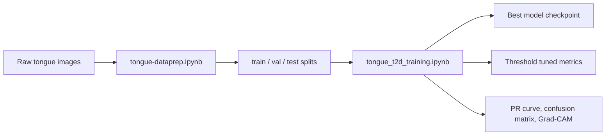

# Tongue Diabetes Detection

> 🧬 Leakage-safe tongue image pipeline for type 2 diabetes detection, built with Kaggle notebooks, CNN transfer learning, and Grad-CAM explainability.

## ✨ At a glance

| Item | Details |
|---|---|
| 🧪 Data prep | Offline augmentation, class balancing, stratified group split, leakage checks |
| 🧠 Training | EfficientNet-B2, ResNet-50, MobileNetV3-Large |
| 📊 Evaluation | PR-AUC selection, threshold tuning, test + external evaluation |
| 🔍 Explainability | Grad-CAM visualizations and confusion matrices |
| 📦 Output | Kaggle-ready split dataset plus model checkpoints and plots |

## 📚 What’s inside

- [tongue-dataprep.ipynb](tongue-dataprep.ipynb) - offline augmentation, group-aware splitting, leakage checks, and Kaggle-ready export.
- [tongue_t2d_training.ipynb](tongue_t2d_training.ipynb) - training, validation, model selection, threshold tuning, external evaluation, and explainability artifacts.
- [notebooks_explanation.md](notebooks_explanation.md) - plain-language description of the notebook workflow.

## 🧭 Workflow

## 🧩 Data preparation

`tongue-dataprep.ipynb` loads the raw dataset from a Kaggle input path, deduplicates image families with a canonical grouping key, applies offline Albumentations augmentation, and performs a stratified group split by participant block. The source dataset photographs each participant several times and numbers those photos consecutively (`r_d_(56)`, `r_d_(57)`, ...), so blocks of 10 consecutive numbers are kept in one split together with all their augmented variants.

### Key behavior

- 📥 Reads the source data from `/kaggle/input/datasets/edamhakim/t2d-tongue-dataset/data/preprocessedcropped`.
- 🎛️ Uses offline augmentation with horizontal flip, shift/scale/rotate, brightness/contrast, blur, noise, and motion blur.
- ⚖️ Balances the classes with controlled oversampling, capped per family.
- ✂️ Splits participant blocks into `70/15/15` for `train/val/test` (block size set by `participant_block_size`).
- 🧪 Verifies leakage with both group-level checks and MD5 hash overlap checks.
- 📁 Writes the final dataset to `/kaggle/working/train`, `/kaggle/working/val`, and `/kaggle/working/test`.
- 🗜️ Creates downloadable archives: `train.zip`, `val.zip`, `test.zip`, and `tongue_preped_bundle.zip`.

The notebook is intended to be published as a Kaggle dataset named `tongue_preped`.

## 🧠 Training

`tongue_t2d_training.ipynb` trains and compares three pretrained CNN backbones:

- EfficientNet-B2
- ResNet-50
- MobileNetV3-Large

It uses a binary classification setup with the following techniques:

- 🩺 MediaPipe-based tongue standardization when available.
- ⭕ Circular masking to reduce background influence.
- 🎯 Weighted sampling to rebalance the training loader.
- 🔥 Focal loss with $\gamma=2.0$ to emphasize hard examples.
- 🔄 Two-stage transfer learning with a warmup phase and a fine-tuning phase.
- 🧬 Mixup augmentation during training.
- 📈 PR-AUC-based model selection.
- 🎚️ Threshold tuning to satisfy a precision target on validation data.
- 🧭 Grad-CAM visualizations for internal and external evaluation.

The notebook also evaluates the selected model on an external dataset and saves plots such as the PR curve and Grad-CAM debug images to `/kaggle/working`.

## 🛠️ Requirements

The notebooks rely on the following main libraries:

- PyTorch
- torchvision
- timm
- albumentations
- OpenCV
- NumPy
- pandas
- scikit-learn
- MediaPipe
- pytorch-grad-cam
- matplotlib
- seaborn
- Pillow

The training notebook installs `grad-cam` and `mediapipe` with a notebook cell, so a Kaggle or notebook environment with internet access is assumed unless those packages are already available.

## 🚀 How to run

### 1) Prepare the dataset

Run `tongue-dataprep.ipynb` first. Confirm that the following folders and archives are created in `/kaggle/working`:

- `/kaggle/working/train/<class_name>/`
- `/kaggle/working/val/<class_name>/`
- `/kaggle/working/test/<class_name>/`
- `/kaggle/working/train.zip`
- `/kaggle/working/val.zip`
- `/kaggle/working/test.zip`
- `/kaggle/working/tongue_preped_bundle.zip`

Then publish the result as a Kaggle dataset and mount it into the training notebook.

### 2) Update the training paths

Before running `tongue_t2d_training.ipynb`, verify the `CFG` paths at the top of the notebook match the actual Kaggle dataset name you published.

Important: the notebook contains a path-name inconsistency in the dataset root strings, so the safest approach is to update `data_root`, `train_dir`, `val_dir`, and `test_dir` together so they all point to the same mounted dataset.

### 3) Train and evaluate

Run the training notebook end to end. It will:

- build the loaders,
- train all three backbones,
- save checkpoints in `/kaggle/working`,
- compare validation metrics,
- tune the classification threshold,
- evaluate on the test split,
- evaluate on the external dataset,
- export PR curves, confusion matrices, and Grad-CAM outputs.

## 📦 Expected outputs

The training notebook saves artifacts such as:

- `<model_name>_best.pt`
- `pr_curve.png`
- `gradcam_debug_internal_test.png`
- `gradcam_debug_external.png`

## ⚠️ Notes and caveats

- The notebooks are Kaggle-oriented and use absolute `/kaggle/...` paths.
- The data preparation notebook assumes the raw dataset is already available in the Kaggle input mount.
- The training notebook expects the prepared split dataset to be mounted as a Kaggle dataset.
- Validation and test splits exclude augmented filenames that contain `__aug_`.
- The project is designed for small medical-image datasets, so the modeling choices favor CNN transfer learning over transformers.

## ✅ Recommended order of execution

1. Run `tongue-dataprep.ipynb`.
2. Publish the generated dataset from `/kaggle/working`.
3. Mount the published dataset in a fresh Kaggle session.
4. Update the `CFG` paths in `tongue_t2d_training.ipynb` if needed.
5. Run the training notebook.
